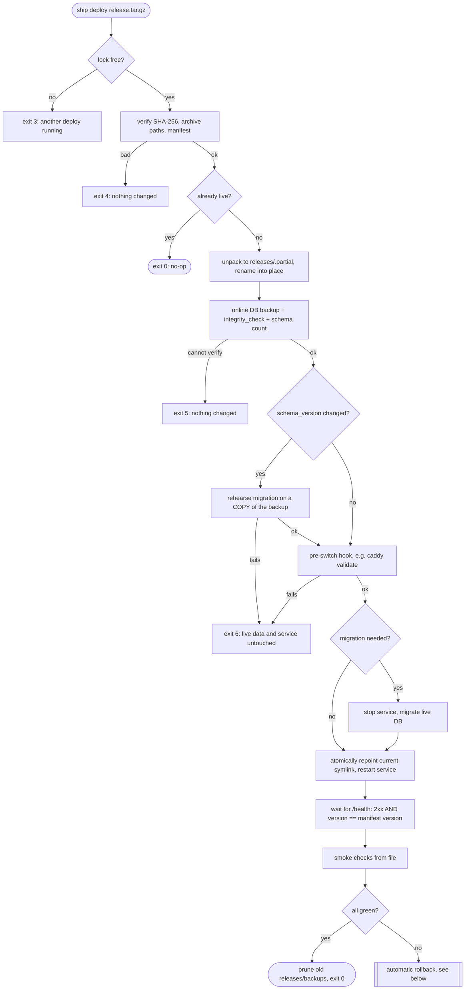
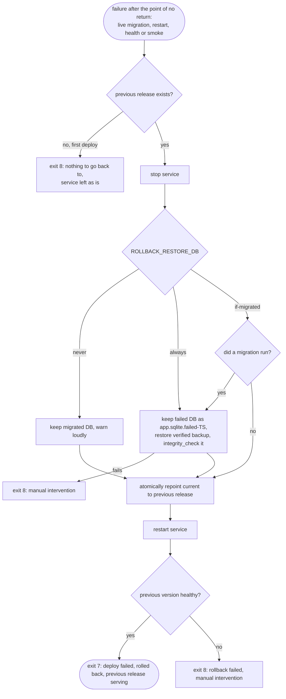

# ship-kit

Safe releases and basic monitoring for an app that lives on **one Linux server**: Node or Python behind systemd and Caddy/nginx, with SQLite (or any file database).

It is two small tools and a demo:

| Part | What it is | Language |
|---|---|---|
| `bin/ship-build` | Builds a versioned tarball with a SHA-256 checksum and a manifest (version, git sha, schema version) | bash |
| `bin/ship` | `deploy`, `rollback`, `status`, `verify`: idempotent, lockable, `--dry-run`, **auto-rollback when health fails** | bash |
| `monitor/` | `watch`: HTTP/TLS-expiry/disk+inode/systemd/backup-age/log-error-rate checks, de-duplicated alerts to a webhook, Telegram or SMTP, a status JSON | TypeScript, zero dependencies |
| `demo/` + `sim/` | A tiny SQLite-backed app with good and bad releases, and a simulated server to run it all on a laptop | Node, bash |

No agents, no SaaS, no containers. Copy two shell scripts and (optionally) one Node program to the server.

## The problem

A solo developer deploying to a single VPS usually has one of two setups: `git pull && systemctl restart` (fast, and one bad commit away from an outage with no way back), or a platform they cannot justify for one box. The failure stories are always the same:

- the new code does not start, and the old code is gone;
- the migration half-applies and the *old* code cannot read the new schema either;
- the backup you were counting on was never verified, or silently stopped running three weeks ago;
- the certificate expired, or the disk filled up, and nobody was told until a customer was.

`ship-kit` encodes the boring checklist: verify what you are about to deploy, prove you can undo it, rehearse the dangerous step on a copy, switch atomically, check the result, and go back by itself if the check fails. Then watch the things that quietly rot.

## How a deploy works



Everything above the "stop service" box leaves the running system untouched. The service is only stopped when a migration is going to run, and only after the rehearsal on a copy succeeded.

## How a rollback decides



Exit **7** means "the deploy failed but you are back where you started". Exit **8** means a human is needed now.

## Quickstart (on a laptop, no server needed)

Requirements: bash, `sqlite3` CLI (or Python 3), `curl`, `tar`, `sha256sum`, Node 22.13 or newer. On Windows use Git Bash.

```bash
git clone https://github.com/Hardik-RK/ship-kit && cd ship-kit

bash demo/demo.sh          # good deploy, broken migration, crashing release, auto-rollback
```

`demo/demo.sh` builds five demo releases and runs them against a throwaway directory using a `systemctl` shim that launches the demo app as a child process. The captured output is in [docs/DEMO-TRANSCRIPT.md](docs/DEMO-TRANSCRIPT.md).

To do the same steps by hand:

```bash
bash demo/make-releases.sh /tmp/dist            # 1.0.0, 1.1.0 good; 1.2.0 1.3.0 1.4.0 bad in different ways
source sim/sim.sh && sim_init                   # temp server root, shims on PATH, ship.conf written
bin/ship deploy /tmp/dist/demo-1.0.0-*.tar.gz
bin/ship deploy /tmp/dist/demo-1.1.0-*.tar.gz --dry-run   # plan only
bin/ship deploy /tmp/dist/demo-1.1.0-*.tar.gz
bin/ship deploy /tmp/dist/demo-1.2.0-*.tar.gz   # crashes on start -> exit 7, DB restored
bin/ship status
sim_cleanup
```

### On a real server

```bash
# on your machine
bin/ship-build --name myapp --version 1.4.2 --src ./build-output --out ./dist   # git sha read from --src
scp dist/myapp-1.4.2-*.tar.gz* deploy@server:/tmp/

# on the server (once): copy bin/ship, create /srv/myapp, write /srv/myapp/ship.conf (examples/ship.conf),
# a systemd unit with WorkingDirectory=/srv/myapp/current (examples/systemd/myapp.service)
export SHIP_ROOT=/srv/myapp
ship deploy /tmp/myapp-1.4.2-*.tar.gz --dry-run
ship deploy /tmp/myapp-1.4.2-*.tar.gz
```

### Monitor

```bash
npm install                                      # dev tools only (typescript, @types/node); the monitor itself has no dependencies
node monitor/src/cli.ts validate  --config examples/monitor.yaml
node monitor/src/cli.ts self-test --config examples/monitor.yaml   # runs the checks, prints what it WOULD send, sends nothing
node monitor/src/cli.ts watch --config examples/monitor.yaml --once   # for cron; exit 1 if anything is warn/crit
node monitor/src/cli.ts watch --config examples/monitor.yaml          # long-running, optional status page
# or compiled JS:  npm run build && node dist/cli.js watch --config examples/monitor.yaml
```

Cron example: `* * * * * cd /opt/ship-kit && node monitor/src/cli.ts watch --config /etc/ship/monitor.yaml --once`.

## Release layout and commands

```
$SHIP_ROOT/
  releases/<version>-<sha7>/   immutable, one per deploy
  current -> releases/...      symlink, replaced with a single rename(2)
  shared/data, shared/backups  survive releases (the DB and verified backups with a .ok sidecar)
  state/                       lock/, history, previous, ship.log
  ship.conf
```

| Command | Does |
|---|---|
| `ship deploy FILE [--dry-run] [--force]` | The flow above. `--dry-run` verifies the artifact and prints the plan; it creates and changes nothing, and still refuses if the lock is held. `--force` redeploys the release that is already live. |
| `ship rollback [--restore-db BACKUP] [--dry-run]` | Switch to the previous release (`state/previous`), optionally restoring a verified backup first, then wait for its health. Running it again goes forward again. |
| `ship status [--json]` | Current/previous release, service state, live health version, newest backup and whether it is verified. Exit 1 if not healthy. |
| `ship verify FILE` | Checksum, path safety and manifest check only. |
| `ship-build` | `--name --version --src [--out --migrations --sha]` |

Exit codes: `0` ok, `1` unexpected or `status` unhealthy, `2` usage/config, `3` lock held, `4` artifact rejected, `5` no verified backup, `6` preflight failed (migration on the copy or pre-switch hook), `7` failed and rolled back, `8` failed and rollback failed, `9` missing tool.

Logs are one logfmt line per event (`ts=... level=info step=backup msg="..." file=...`) on stdout/stderr and appended to `state/ship.log`.

### ship.conf reference

Sourced as bash (so it is code you own). See [examples/ship.conf](examples/ship.conf).

| Variable | Default | Meaning |
|---|---|---|
| `SERVICE` | required | systemd unit to restart |
| `HEALTH_URL` | required | endpoint returning 2xx JSON; smoke paths resolve against its directory |
| `HEALTH_VERSION_FIELD` | `version` | JSON field that must equal the manifest version |
| `HEALTH_TIMEOUT` / `HEALTH_INTERVAL` | `30` / `1` | seconds to wait / poll interval |
| `SYSTEMCTL` | `systemctl` | command prefix, e.g. `sudo systemctl` |
| `DB_PATH` | empty | database file; empty skips all DB steps |
| `DB_KIND` | `sqlite` | `sqlite` online backup + `integrity_check`; `file` plain copy (only safe if the app is idle) |
| `BACKUP_DIR` / `BACKUP_KEEP` | `$SHIP_ROOT/shared/backups` / `10` | where verified backups go, how many to keep |
| `KEEP_RELEASES` | `5` | releases kept (never the current or previous one) |
| `MIGRATE_CMD` | empty | run inside the new release dir with `SHIP_DB_PATH`; once on a copy, once on the live DB. Only runs when `schema_version` changed |
| `ROLLBACK_RESTORE_DB` | `if-migrated` | `if-migrated`, `always`, `never` |
| `SMOKE_FILE` | empty | one check per line: `METHOD PATH STATUS [\| must-contain [\| request body]]` |
| `PRE_SWITCH_HOOK` / `POST_SUCCESS_HOOK` | empty | commands run in the release dir; the first aborts on failure, the second only warns |

### monitor config reference

One YAML or JSON file; the schema is in [monitor/config.schema.json](monitor/config.schema.json) (generated from the validator's own tables). Unknown keys are errors, so typos are caught. All problems are reported at once.

```yaml
name: demo-app
intervalSeconds: 60
stateFile: /var/lib/ship-monitor/state.json    # needed for --once to remember between runs
statusFile: /var/lib/ship-monitor/status.json
serve: {port: 9100}                            # optional read-only GET /status.json (watch mode)
alerting: {failAfter: 2, recoverAfter: 2, repeatMinutes: 120, flap: {threshold: 4, windowMinutes: 30}}
notifiers: [...]   # webhook | telegram | email
checks: [...]      # http | tls | disk | systemd | backup | lograte
```

| Check | Key options (defaults) | Goes warn/crit when |
|---|---|---|
| `http` | `url`, `expectStatus` (200), `warnLatencyMs`, `critLatencyMs`, `json: {field, equals\|exists}`, `timeoutMs` (5000) | wrong status, timeout, refused, slow, JSON field wrong |
| `tls` | `host`, `port` (443), `warnDays` (21), `critDays` (7), `requireTrusted` (false) | days to expiry at or below thresholds; expired is always crit |
| `disk` | `path`, `warnPercent` (80), `critPercent` (90), `inodeWarnPercent`, `inodeCritPercent` | space **or** inode use above thresholds (df arithmetic) |
| `systemd` | `unit` | anything but `active` (`activating` is warn) |
| `backup` | `dir`, `pattern` (`\.bak$`), `requireMarker`, `warnHours` (26), `critHours` (50) | newest matching file too old, empty, or none. `requireMarker: true` only counts backups with a `.ok` sidecar, which is what `ship` writes after verification |
| `lograte` | `file`, `windowMinutes` (10), `errorPattern`, `warnCount`/`critCount`, `warnRatePercent`/`critRatePercent`, `minLinesForRate` (20) | errors in the time window. Lines need an ISO-8601 timestamp somewhere; continuation lines (stack traces) inherit the previous line's time; no-timezone stamps are read as UTC |
| notifier `webhook` | `url`, `headers` | POSTs JSON with `text` and `content` (Slack/Discord style) plus structured fields |
| notifier `telegram` | `tokenEnv`, `chatId` | token is read from that environment variable, never from the file |
| notifier `email` | `host`, `port` (587), `starttls` (true), `secure`, `user`, `passEnv`, `from`, `to[]`, `insecureTls` | plain SMTP client; refuses to send credentials without TLS |

Alerting rules: a status change is confirmed only after `failAfter`/`recoverAfter` consecutive readings (a single blip alerts nobody); each confirmed status is announced once and repeated only as a reminder every `repeatMinutes`; recovery is sent only if the problem was announced; if a check changes confirmed status `flap.threshold` times in `flap.windowMinutes` it sends one "flapping" notice, goes quiet, then sends one "stable" notice. If **no** notifier accepts an alert, it is retried on the next run.

## What each safety check protects against

| Check | Protects against | Does not protect against |
|---|---|---|
| SHA-256 + manifest + path check | truncated or corrupted upload; the wrong file; a tarball that writes outside the release dir | a malicious artifact **and** a matching malicious `.sha256` (no signatures; see DESIGN.md) |
| Unpack to hidden dir, then rename | a half-unpacked release being switched to after a dropped SSH session | |
| Verified online backup (backup API + `integrity_check` + object-count compare) | "the backup was zero bytes / corrupt and I only found out when I needed it"; copying a DB file mid-write | corruption that `integrity_check` cannot see (wrong data that is structurally valid) |
| Refuse to continue without a verified backup | migrating with no way back | |
| Migration rehearsal on a copy | syntax errors, constraint violations and data-dependent failures that only show on real data | migrations that succeed but are *semantically* wrong; load/lock-time problems at production scale |
| Atomic symlink switch | a window where `current` is missing or half-written | |
| Health must report the **new version** | an old process still answering `/health` while the new one fails to start (a classic false green) | an app whose `/health` lies |
| Smoke checks | "healthy but the main page 500s" | anything you did not write a check for |
| Auto-rollback + DB restore | leaving users on a broken release at 3 a.m. | writes made between the backup and the rollback are **lost** (they are in `app.sqlite.failed-TS`, not merged) |
| Lock (mkdir + pid, stale reclaim) | two concurrent deploys, or a deploy during a rollback | someone editing files in `releases/` by hand |
| Monitor: backup age | "the backup job died three weeks ago" | a backup that exists but is not restorable (restore-test it) |
| Monitor: TLS days left | certificate renewal quietly failing | a certificate that is valid but for the wrong name (use `requireTrusted`) |
| Monitor: disk **and inodes** | log/upload growth, a million tiny files | |
| Monitor: flap damping and de-duplication | a pager that cries wolf, so you mute it | |

## Failure modes and what it does NOT protect against

Be honest with yourself about these before relying on it.

- **Data written between backup and rollback is discarded** when the DB is restored. For a busy write-heavy app, prefer additive, backward-compatible migrations (expand, deploy, contract) and `ROLLBACK_RESTORE_DB=never`; ship will still tell you if the old code then cannot start (exit 8).
- **Migrations stop the service.** Deploys with a schema change have downtime of roughly the migration time. No zero-downtime or blue/green. Deploys without a schema change are a restart (a second or two).
- **One server is one point of failure.** This does not give you high availability, failover, or off-site backups. Copy `shared/backups` elsewhere (restic, rclone, object storage); the monitor can alert on freshness, not on location.
- **A passing health check is not correctness.** It proves the process answers, reports the right version, and passes your smoke file.
- **The checksum file travels with the artifact.** It detects accidents, not an attacker who can replace both. Verify the tarball hash out of band, or sign it.
- **`ship.conf` and hooks are executed as the deploy user.** Protect them like code.
- **Real systemd behaviour is simulated in tests** (see Testing). `Restart=` policies, `ExecStartPre`, socket activation and cgroup kill semantics are not exercised.
- **The JSON handling is deliberately shallow:** the manifest and health response are read with `sed` for flat fields. Nested or escaped values are not supported.
- **Linux only** (`readlink -f`, GNU `mv -T`, `ln -sfn`, GNU `tar`). The test harness runs on Windows Git Bash via shims, which is a test convenience, not a supported deployment target.
- **The monitor is not an alert manager.** It runs on the box it watches unless you run it elsewhere; if the box is down, it is down with it. Point an external uptime check at the public URL too.

## Why not Kubernetes / Docker here

Because the problem is one process on one machine, and every extra layer adds failure modes you then have to monitor.

- Kubernetes buys scheduling, self-healing across nodes, and rolling updates across replicas. With one node there is nothing to schedule across; you would operate a control plane to restart one pod.
- Docker is fine, and you can run this app in a container under systemd. But the *release* problem (verify, back up, rehearse the migration, switch, check, roll back) is the same, and it is about the **database**, which no image tag rolls back. `ship` solves that part either way.
- A tarball + symlink gives you instant rollback (flip a pointer), zero registry, zero image build on the server, and a release you can `ls` and `diff`.

If you outgrow one box (second server, zero-downtime requirement, many services), that is the time to adopt an orchestrator, and the lessons here (health with version, rehearse migrations, verified backups) carry over unchanged.

## Testing

```bash
npm install
npm test                    # monitor unit tests + bash harness
npm run test:monitor        # 65 tests, a few seconds
npm run test:ship           # 32 harness tests; about 30-50 min on Windows Git Bash (process spawn is slow), expected to be far quicker on Linux (not measured)
bash test/ship.test.sh dry_run   # run tests whose name contains "dry_run"
npm run typecheck && npm run build
```

- **Harness (`test/ship.test.sh`)**: the real `ship` and `ship-build`, real `tar`/`sha256sum`/`sqlite3`/`curl`, the real demo app as a child process on a random port, in a temp directory per test. Faked: `systemctl` and `caddy` (`sim/shims`). On Windows, where unprivileged Git Bash cannot create symlinks, a pointer-file `ln`/`readlink` shim stands in for the `current` symlink; on Linux (CI) real symlinks are used.
- **Monitor tests** use a fake clock for the alert state machine and TLS expiry, local HTTP servers for latency/status/JSON checks, a local HTTPS server with a throwaway self-signed certificate (needs the `openssl` CLI), and a fake SMTP server (plain, STARTTLS and AUTH).
- CI (`.github/workflows/ci.yml`): shellcheck, the harness on Ubuntu and inside a Debian 12 container, typecheck + monitor tests on Node 22 and 24, and the compiled-JS build.

## Repository map

```
bin/ship  bin/ship-build        the release tools (bash)
monitor/src  monitor/test       the monitor (TypeScript, runs on Node 22+ with type stripping)
demo/app                        sample service + migrations;  demo/make-releases.sh  demo/demo.sh
sim/                            simulated server: systemctl/caddy shims, symlink shims for Windows
examples/                       ship.conf, smoke.txt, monitor.yaml/json, systemd unit, Caddyfile, sudoers
docs/DESIGN.md                  decisions and trade-offs
docs/DEMO-TRANSCRIPT.md         real captured output of demo/demo.sh
```

## Licence

MIT, see [LICENSE](LICENSE).
