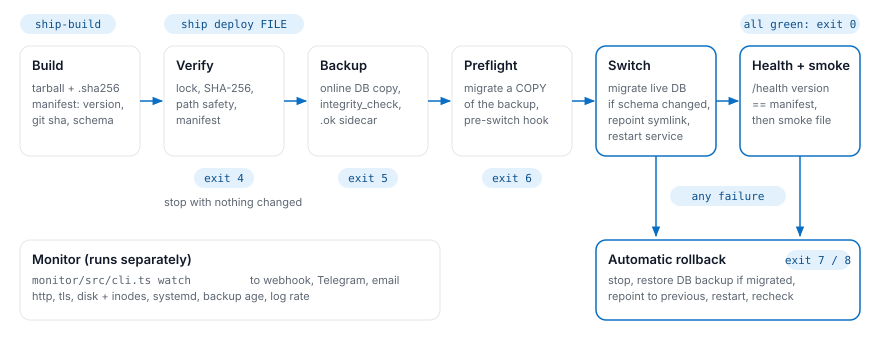

# ship-kit

Release and monitoring scripts for a Node or Python app on one Linux server (systemd, Caddy or nginx, SQLite or another file database) that roll a bad deploy back automatically.



## What it does

- Deploys a checksummed tarball (`.sha256` sidecar, manifest, path-safety check)
- SQLite online backup plus `integrity_check` before every deploy; `.ok` sidecar on verified backups
- Migration rehearsed on a copy of the database before the live run
- `current` symlink switched with one `rename(2)`; health must report the new version
- Automatic rollback on failure: exit 7 back on the old release, exit 8 needs a person
- Monitor for HTTP, TLS expiry, disk and inodes, systemd units, backup age, log error rate
- Alerts to webhook, Telegram or email, with flap damping and de-duplication; no runtime dependencies

## Quick start

Prerequisites: bash, `sqlite3` CLI (or Python 3), `curl`, `tar`, `sha256sum`, Node 22.13+. On Windows use Git Bash.

Demo, no server needed ([captured output](docs/DEMO-TRANSCRIPT.md)):

```bash
git clone https://github.com/Hardik-RK/ship-kit && cd ship-kit
bash demo/demo.sh   # good deploy, broken migration, crashing release, auto-rollback
```

The same by hand in a simulated server:

```bash
bash demo/make-releases.sh /tmp/dist            # 1.0.0, 1.1.0 good; 1.2.0-1.4.0 broken
source sim/sim.sh && sim_init                   # temp server root, shims on PATH, ship.conf written
bin/ship deploy /tmp/dist/demo-1.0.0-*.tar.gz
bin/ship deploy /tmp/dist/demo-1.1.0-*.tar.gz --dry-run   # plan only
bin/ship deploy /tmp/dist/demo-1.1.0-*.tar.gz
bin/ship deploy /tmp/dist/demo-1.2.0-*.tar.gz   # crashes on start: exit 7, DB restored
bin/ship status
sim_cleanup
```

On a real server:

```bash
# local: build the release (git sha read from --src)
bin/ship-build --name myapp --version 1.4.2 --src ./build-output --out ./dist
scp dist/myapp-1.4.2-*.tar.gz* deploy@server:/tmp/

# server, once: copy bin/ship, create /srv/myapp with ship.conf (examples/ship.conf)
# and a unit with WorkingDirectory=/srv/myapp/current (examples/systemd/myapp.service)
export SHIP_ROOT=/srv/myapp
ship deploy /tmp/myapp-1.4.2-*.tar.gz --dry-run
ship deploy /tmp/myapp-1.4.2-*.tar.gz
```

Monitor:

```bash
npm install                                                           # dev tools only
node monitor/src/cli.ts validate  --config examples/monitor.yaml      # check the config
node monitor/src/cli.ts self-test --config examples/monitor.yaml      # run checks, send nothing
node monitor/src/cli.ts watch --config examples/monitor.yaml --once   # for cron; exit 1 on warn/crit
node monitor/src/cli.ts watch --config examples/monitor.yaml          # long-running
```

## Commands

| Command | Options | Does |
|---|---|---|
| `ship deploy FILE` | `--dry-run`, `--force` | Full release flow. `--dry-run` verifies and prints the plan, changes nothing. `--force` redeploys the live release. |
| `ship rollback` | `--restore-db BACKUP`, `--dry-run` | Switch to `state/previous`, optionally restoring a verified backup first. Run again to go forward. |
| `ship status` | `--json` | Current and previous release, service state, live health version, newest backup. Exit 1 if unhealthy. |
| `ship verify FILE` | | Checksum, path safety and manifest only. |
| `ship-build` | `--name --version --src [--out --migrations --sha]` | Writes `NAME-VERSION-SHA7.tar.gz` and its `.sha256`. |

All `ship` commands also take `--config FILE` and `--root DIR`.

Exit codes: `0` ok, `1` unexpected error or unhealthy, `2` usage/config, `3` lock held, `4` artifact rejected, `5` no verified backup, `6` preflight failed, `7` failed and rolled back, `8` rollback also failed, `9` missing tool.

Configuration: [examples/ship.conf](examples/ship.conf) (sourced as bash, commented) and [monitor/config.schema.json](monitor/config.schema.json) for the monitor (YAML or JSON; unknown keys are errors).

## How a release works

- Nothing before the switch touches the running system. The service stops only for a schema change with `MIGRATE_CMD` set, after the rehearsal passed.
- An old process still answering `/health` does not count: the reported version must match the manifest.
- On failure `ship` stops the service, restores the backup per `ROLLBACK_RESTORE_DB` (`if-migrated` default, `always`, `never`), keeps the failed DB as `app.sqlite.failed-TS`, repoints `current` and checks the old version is healthy.
- A failed first deploy exits 8: there is nothing to go back to.

## Tests

```bash
npm install && npm test   # 65 monitor unit tests, then 32 bash harness tests
bash test/ship.test.sh dry_run   # only harness tests whose name contains "dry_run"
```

The harness runs the real `ship` with real `tar`, `sha256sum`, `sqlite3` and `curl`; `systemctl` and `caddy` are shims. Slow on Windows Git Bash. CI: shellcheck, harness on Ubuntu and Debian 12, monitor on Node 22 and 24.

## Layout

```
bin/        ship and ship-build (bash)
monitor/    the monitor (TypeScript) and its tests
demo/       sample app, migrations, demo scripts
sim/        systemctl/caddy and symlink shims
examples/   ship.conf, monitor config, systemd unit, Caddyfile, sudoers
docs/       DESIGN.md, demo transcript, diagram
```

## Limitations

- Data written between backup and rollback is lost when the DB is restored (kept in `app.sqlite.failed-TS`, not merged). For write-heavy apps use backward-compatible migrations and `ROLLBACK_RESTORE_DB=never`; `ship` still exits 8 if the old code cannot start.
- Migrations stop the service: downtime of about the migration time. No zero-downtime or blue/green.
- One server, one point of failure. No failover or off-site backups; copy `shared/backups` elsewhere yourself.
- No release signing yet. The `.sha256` travels with the tarball, so it catches corruption, not an attacker who replaces both. Signing is next; see [docs/DESIGN.md](docs/DESIGN.md).
- A passing health check shows the process answers with the right version and passes the smoke file, not that it is correct.
- Backups are checked with `integrity_check` and an object-count compare, not restored into a running app.
- `ship.conf` and hooks run as the deploy user; protect them like code.
- systemd is simulated in tests: `Restart=`, `ExecStartPre`, socket activation and cgroup kills are not exercised.
- Manifest and health JSON are read with `sed`; flat fields only.
- Linux only (`readlink -f`, GNU `mv -T`, GNU `tar`). Git Bash is for tests.
- The monitor runs on the box it watches unless moved. Add an external uptime check.
